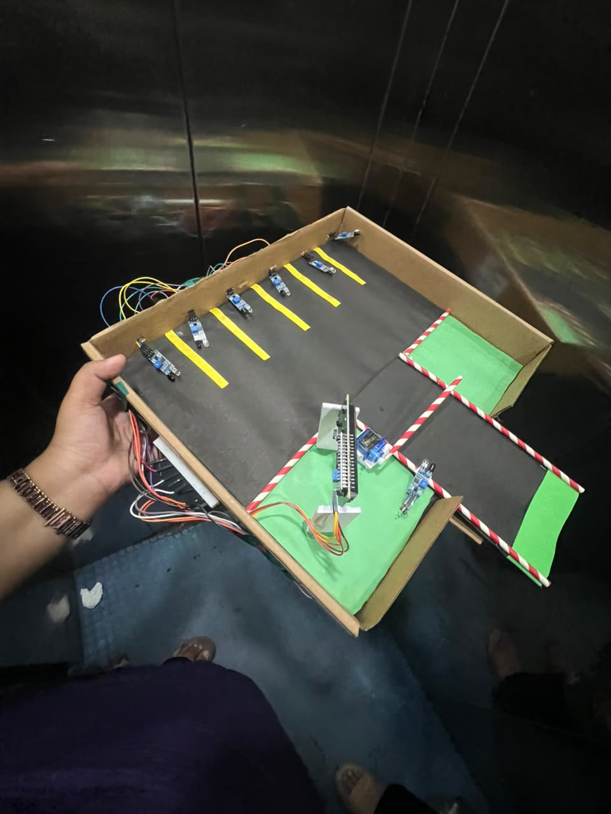
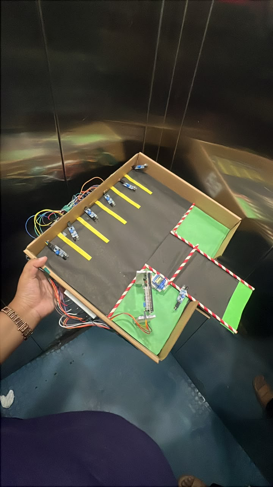
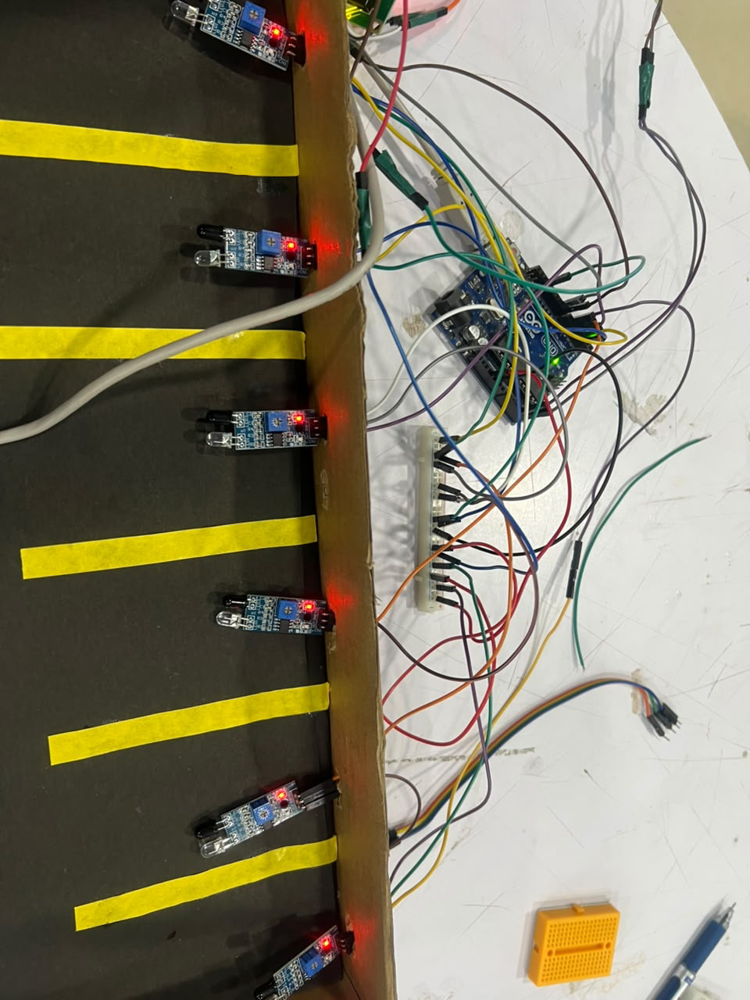
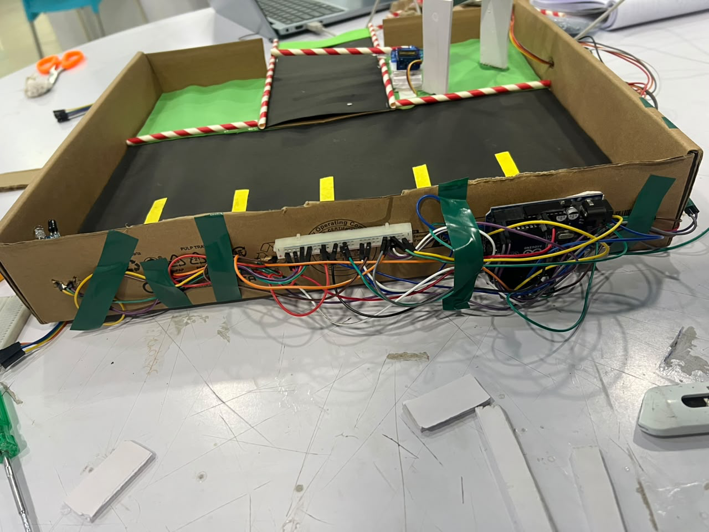
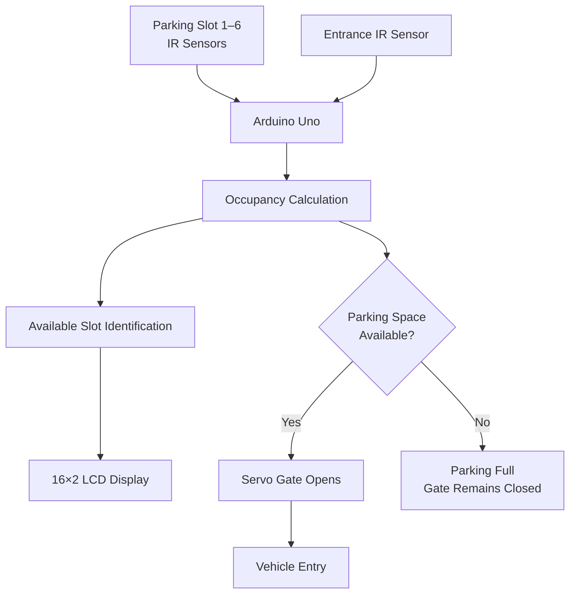
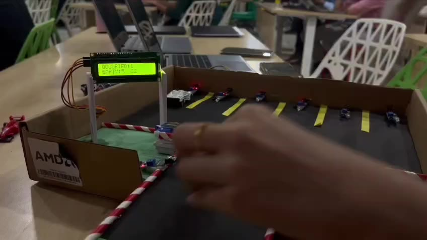

# Smart IoT-Based Parking System

An Arduino-based automated parking management prototype designed to monitor parking-space availability, identify vacant slots, and control vehicle entry through an intelligent gate mechanism.

\<p align="center">   \ \</p>

\<p align="center">   \<strong>Automated Parking · IR-Based Detection · Real-Time Monitoring · Servo-Controlled Gate\</strong> \</p>

---

## Overview

Finding available parking spaces can be time-consuming, particularly in areas where parking availability is not clearly communicated.

The **Smart IoT-Based Parking System** addresses this problem through a miniature automated parking prototype built using Arduino Uno, infrared sensors, an LCD display, and a servo motor.

The system monitors six individual parking slots using IR sensors and continuously calculates the number of occupied and available spaces. When a vehicle approaches the entrance, an additional IR sensor detects its presence. If a parking space is available, the system identifies the first vacant slot, displays its number on the LCD, and activates the servo-controlled entrance gate.

When all six parking spaces are occupied, the system displays a parking-full notification and keeps the entrance gate closed.

The project demonstrates the practical application of embedded systems, sensor integration, automation, and hardware–software interaction.

## Key Features

| Feature                | Description                                                 |
| ---------------------- | ----------------------------------------------------------- |
| Six-Slot Monitoring    | Independently monitors six parking spaces using IR sensors. |
| Vehicle Detection      | Detects vehicles occupying individual parking slots.        |
| Occupancy Calculation  | Automatically calculates occupied and vacant spaces.        |
| Slot Identification    | Identifies the first available parking slot.                |
| LCD Display            | Displays parking availability and slot information.         |
| Entrance Detection     | Detects vehicles approaching the parking entrance.          |
| Automatic Gate Control | Operates the entrance barrier using a servo motor.          |
| Parking-Full Detection | Prevents the gate from opening when all slots are occupied. |
| Serial Monitoring      | Displays system events through the Arduino Serial Monitor.  |

## Physical Prototype

The system was implemented as a miniature parking-lot model with individually marked parking bays, strategically positioned IR sensors, an Arduino controller, and an automated entrance barrier.

\<p align="center">
&#x20; \
\</p>

\<p align="center">
&#x20; \
\</p>

\<p align="center">
&#x20; \
\</p>

## Hardware Components

| Component                 |    Quantity | Purpose                                          |
| ------------------------- | ----------: | ------------------------------------------------ |
| Arduino Uno               |           1 | Central processing and control unit              |
| IR Obstacle Sensors       |           7 | Six parking-slot sensors and one entrance sensor |
| 16×2 LCD Display with I2C |           1 | Displays parking information                     |
| Servo Motor               |           1 | Controls the entrance barrier                    |
| Jumper Wires              | As required | Hardware connections                             |
| Power Supply              | As required | Powers the electronic components                 |
| Physical Model            |           1 | Represents the parking infrastructure            |

## Software and Technologies

- **Programming Language:** Embedded C/C++ (Arduino)
- **Microcontroller Platform:** Arduino Uno
- **Development Environment:** Arduino IDE
- **Sensor Interface:** Digital GPIO
- **Display Communication:** I2C
- **Actuator Control:** Servo motor interface
- **Libraries:** Wire, LiquidCrystal_I2C, Servo

## System Architecture

The Arduino Uno acts as the central controller, receiving information from the parking and entrance sensors and coordinating the LCD display and servo motor.



## Pin Connections

The following table documents the connections defined in the Arduino firmware.

| Component        | Arduino Uno Pin | Purpose                       |
| ---------------- | --------------- | ----------------------------- |
| Parking Sensor 1 | D2              | Slot 1 occupancy              |
| Parking Sensor 2 | D3              | Slot 2 occupancy              |
| Parking Sensor 3 | D4              | Slot 3 occupancy              |
| Parking Sensor 4 | D5              | Slot 4 occupancy              |
| Parking Sensor 5 | D6              | Slot 5 occupancy              |
| Parking Sensor 6 | D7              | Slot 6 occupancy              |
| Entrance Sensor  | D8              | Vehicle detection at entrance |
| Servo Motor      | D9              | Entrance gate control         |
| LCD SDA          | A4              | I2C data                      |
| LCD SCL          | A5              | I2C clock                     |
| LCD VCC          | 5V              | Power supply                  |
| LCD GND          | GND             | Ground                        |
| IR Sensor VCC    | 5V              | Power supply                  |
| IR Sensor GND    | GND             | Ground                        |

**Sensor configuration:** The firmware uses `INPUT_PULLUP` and assumes that a detected vehicle produces a `LOW` signal. Verify the output polarity of the actual IR modules before connecting or modifying the circuit.

**Power consideration:** The servo motor may require an external regulated supply depending on its specifications. When using a separate supply, connect its ground to Arduino GND.

## Working Principle

The system follows a continuous monitoring and decision-making process.

**1. System Initialization**

The Arduino initializes the IR sensors, LCD display, servo motor, and Serial communication.

**2. Parking-Slot Monitoring**

Each of the six IR sensors is read to determine whether its corresponding parking slot is occupied.

**3. Occupancy Calculation**

The Arduino calculates:

- Total occupied parking spaces.
- Total available parking spaces.
- First available parking-slot number.

**4. LCD Status Update**

The LCD displays the current parking status, including occupied and vacant counts and the next available slot.

**5. Vehicle Detection at Entrance**

A separate IR sensor detects an approaching vehicle.

**6. Availability-Based Decision**

- If parking space is available, the LCD displays the suggested slot and the servo motor opens the entrance gate.
- If all six slots are occupied, the LCD displays `PARKING FULL` and the gate remains closed.

**7. Gate Operation**

After the programmed waiting interval, the servo motor returns the gate to its closed position.

The process repeats continuously, allowing the system to monitor parking availability.

## Software Implementation

The Arduino firmware is organized around the following functions:

| Function                 | Responsibility                                      |
| ------------------------ | --------------------------------------------------- |
| `setup()`                | Initializes hardware, sensors, LCD, and servo       |
| `loop()`                 | Performs continuous parking monitoring              |
| `displayParkingStatus()` | Displays occupancy and available-slot information   |
| `openGate()`             | Activates the entrance barrier                      |
| `closeGate()`            | Returns the entrance barrier to its closed position |

The firmware uses digital sensor readings, conditional logic, iteration, and servo control to implement the parking-management workflow.

## Getting Started

### Prerequisites

- Arduino IDE installed.
- Arduino Uno board support.
- Compatible `LiquidCrystal_I2C` library.
- Servo library.
- Required physical hardware components.

### Installation and Execution

**1. Clone the repository**

```bash
git clone https://github.com/siribillakanti/Smart-IoT-Parking-System.git
```

**2. Navigate to the project**

```bash
cd Smart-IoT-Parking-System
```

**3. Open the Arduino firmware**

Open:

```text
src/SmartParkingSystem.ino
```

using Arduino IDE.

**4. Configure the board**

- Select Arduino Uno.
- Select the appropriate serial port.
- Verify the sensor and LCD connections.

**5. Install the required library**

Install a compatible `LiquidCrystal_I2C` library if it is not already available.

**6. Compile and upload**

Verify the sketch and upload it to the Arduino Uno.

**7. Monitor system output**

Open the Serial Monitor and configure the baud rate to `9600`.

The LCD is configured with I2C address `0x27`. Verify the address of your LCD module if it does not initialize.

## Project Demonstration

A physical demonstration of the prototype is included below.

\<p align="center">
&#x20; \<a href="assets/demo/physical-prototype-demo.mp4">
&#x20;   \
&#x20; \</a>
\</p>

\<p align="center">
&#x20; \<strong>\<a href="assets/demo/physical-prototype-demo.mp4">▶ Watch Project Demonstration\</a>\</strong>
\</p>

## Project Documentation

The repository includes additional project materials:

| Resource                                                             | Description                                                          |
| -------------------------------------------------------------------- | -------------------------------------------------------------------- |
| [Project Presentation](assets/presentation/project-presentation.pdf) | Project explanation and presentation slides                          |
| [Project Report](docs/project-report-redacted.pdf)                   | Academic project report with student identification numbers redacted |
| [Project Documentation](docs/project-documentation.md)               | Technical project documentation                                      |
| [Code Review](docs/code-review.md)                                   | Firmware review and implementation notes                             |
| [Prototype Images](assets/prototype/)                                | Physical implementation photographs                                  |

## Technical Scope

The current prototype demonstrates local sensor-based parking detection, occupancy calculation, LCD-based status reporting, and automated entrance-barrier control.

The system is designed around a modular hardware architecture, providing opportunities for future integration with network-connected controllers and remote monitoring platforms.

Potential development directions include:

- ESP32-based wireless connectivity.
- Cloud-based parking occupancy monitoring.
- Web-based parking management dashboard.
- Mobile application integration.
- Parking reservation and entry/exit tracking.
- Historical parking-usage analytics.
- Improved vehicle-passage detection and non-blocking gate control.

These are proposed extensions rather than features of the current implementation.

## Repository Structure

```text
Smart-IoT-Parking-System/
│
├── src/
│   └── SmartParkingSystem.ino
│
├── docs/
│   ├── code-review.md
│   ├── project-documentation.md
│   └── project-report-redacted.pdf
│
├── assets/
│   ├── demo/
│   │   ├── demo-frame.jpg
│   │   └── physical-prototype-demo.mp4
│   │
│   ├── presentation/
│   │   └── project-presentation.pdf
│   │
│   └── prototype/
│       ├── prototype-overview-1.png
│       ├── prototype-overview-2.png
│       ├── ir-sensor-and-controller-wiring.png
│       └── prototype-rear-wiring.png
│
├── README.md
├── CONTRIBUTING.md
├── NOTICE.md
└── .gitignore
```

## Team

This project was developed as an academic group project by:

- **Billakanti Siri**
- K. Bhavana
- M. Geethika
- Nuguri Siri

**Institution:** Koneru Lakshmaiah University (KLU)
**Program:** B.Tech – Computer Science and Engineering
**Academic Year:** 2026–2027

---

\<p align="center">
&#x20; \<strong>Smart IoT-Based Parking System\</strong>
&#x20; \<br>
&#x20; Embedded Systems · Sensor Integration · Automation
&#x20; \<br>\<br>
&#x20; Built with Arduino Uno and IR-based sensing.
\</p>
